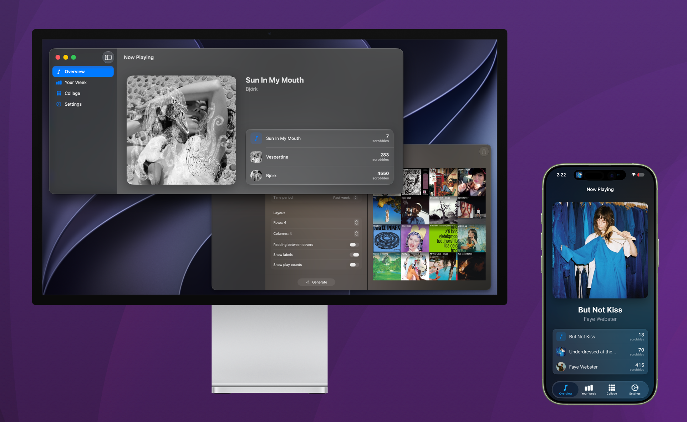

# Scrobblrr
A scrobbler for macOS and iOS, focused on Apple Music support. Automatically fixes your tags, integrates with iMessage, and much more for a better listening experience.

## Downloads
- macOS: [Download from GitHub](https://github.com/lyricalsoul/Scrobblrr/releases)
- Homebrew: `brew install --cask lyricalsoul/tap/scrobblrr`
- iOS: [Join the TestFlight beta](https://testflight.apple.com/join/tAWM91xV)

## TODO
- [X] Clean up code
- [X] Test support on devices w/ no Apple Intelligence
- [ ] Find an app icon
- [X] Enhance SilentAudioKeeper for better life time on iOS
- [X] Musicorum API integration
- [X] Actually push to App Store Connect
- [ ] iMessage app for sending collages and now playing song info (getting there)
